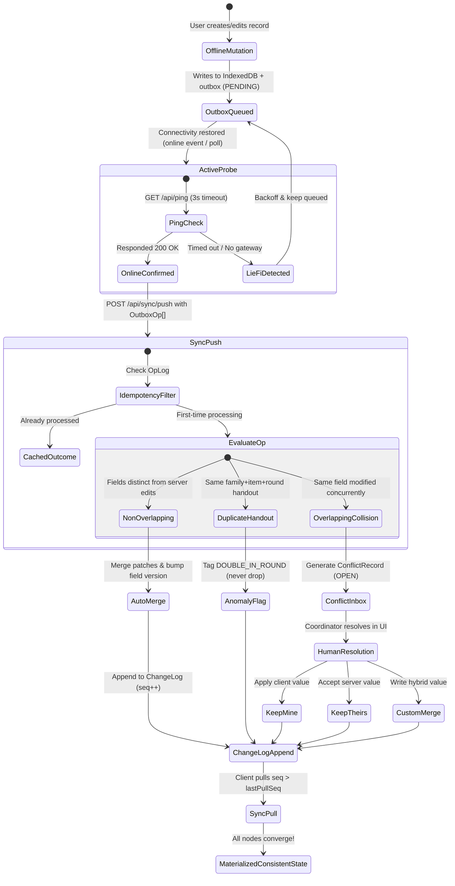

# ReliefSync: Offline-First Disaster Camp Management & Semantic Sync Engine

[](https://github.com/Sumanth069/ReliefSync)
[](https://github.com/Sumanth069/ReliefSync)
[](https://github.com/Sumanth069/ReliefSync)
[](https://github.com/Sumanth069/ReliefSync)
[](https://github.com/Sumanth069/ReliefSync)

> **Submission for Algothon'26 | Track: Web Development (Offline-First Application)**  
> *An offline-first PWA for flood relief camps: register families, log aid distributions, and track inventory with zero network connectivity, then synchronize safely with field-level 3-way merge, ensuring every conflict is detected and resolved—never silently overwritten.*

---

## 📑 Table of Contents
1. [The Problem & The ReliefSync Thesis](#1-the-problem--the-reliefsync-thesis)
2. [Why Generic Sync Fails in Disasters](#2-why-generic-sync-fails-in-disasters)
3. [System Architecture](#3-system-architecture)
4. [Conflict Resolution & Semantic State Machine](#4-conflict-resolution--semantic-state-machine)
5. [The Correctness Scoreboard (Verified Invariants)](#5-the-correctness-scoreboard-verified-invariants)
6. [Field Realism: Solving Real Browser Quirks](#6-field-realism-solving-real-browser-quirks)
7. [API Protocol Specification](#7-api-protocol-specification)
8. [3-Minute Live Evaluation Script (For Judges)](#8-3-minute-live-evaluation-script-for-judges)
9. [Local Setup & Testing](#9-local-setup--testing)

---

## 1. The Problem & The ReliefSync Thesis

### Problem Statement (PS ID: ALG-WEB-02)
> *"Many web applications become unusable when connectivity is unstable. Build an app that remains useful offline and synchronizes safely later. Must have: Offline cache, Offline CRUD, Pending changes outbox, Connectivity detection, Synchronization, Sync status. Innovation/Bonus: Conflicting edits from two offline devices must be detected and handled without silent overwrite."*

### The ReliefSync Thesis: Correctness is the Product
Most offline-first submissions build generic note-taking or to-do list applications and resolve conflicts with a primitive **Last-Write-Wins (LWW)** strategy or generic CRDTs.

In disaster relief operations (e.g. flood camps, cyclone shelters), **data conflicts represent physical human events**:
- If two volunteers offline hand out the last 20 medical kits to two different families, **both medical kits were already handed out**. Rejecting one transaction or rolling it back corrupts camp ground truth.
- If two volunteers concurrently register family updates (one fixes phone number, another updates family size), **neither edit should be discarded**.
- If two volunteers concurrently edit the **same** field (e.g. conflicting head of household names), **the system must never silently overwrite**. It must flag a side-by-side human resolution.

**ReliefSync** implements a **domain-aware semantic synchronization layer** on top of a deterministic, append-only operation log and Hybrid Logical Clocks.

---

## 2. Why Generic Sync Fails in Disasters

| Generic Sync Approach (Firestore / PouchDB / LWW) | Real Flood Camp Failure Mode | How ReliefSync Solves It |
|---|---|---|
| **Last-Write-Wins (LWW)** | Volunteer B reconnects 5 seconds after Volunteer A; Volunteer A's edits are silently erased forever. | **Field-level version vectors (`baseFieldVersions`)**: Non-overlapping fields auto-merge; overlapping collisions route to Conflict Inbox. |
| **Strict Reject on Stock Depletion** | Rejects Volunteer B's distribution transaction because camp stock reached 0. Volunteer B already gave the blanket away. | **Commutative Ledger Deltas**: Accepts negative stock balance and flags a `STOCK_DISCREPANCY` review. |
| **Reject on Duplicate Distribution** | Volunteer inadvertently hands rations twice in Round 1. System throws network error or rejects log. | **Ground-Truth Anomaly Flags**: Accepts handout, flags `ANOMALY: DOUBLE_IN_ROUND` for coordinator review. |
| **Untrusted Device Clocks** | Field phone has clock skewed by 2 days due to dead battery; corrupts timestamp ordering. | **Hybrid Logical Clocks (HLC)**: Strict causal ordering (`<wall>-<counter>-<node>`) immune to clock skew. |

---

## 3. System Architecture

```mermaid
flowchart TD
    subgraph Client ["Client Device (PWA / Field Volunteer Phone)"]
        UI["UI Layer (Next.js / Tailwind CSS / Lucide)"]
        SW["Service Worker (sw.js - App Shell Precache)"]
        Dexie["Local IndexedDB Store (Dexie.js)
        - families
        - distributions
        - stockMovements
        - outbox (Immutable Queue)
        - conflicts
        - meta"]
        Engine["Foreground Sync Engine (syncEngine.ts)
        - Active Ping Probe (Lie-Fi Detector)
        - Idempotent Batch Push Loop
        - Monotonic Cursor Pull Loop"]
        HLC["Hybrid Logical Clock (HLC)
        <wall_ms>-<counter>-<deviceId>"]
    end

    subgraph Server ["Camp Coordinator Server / Edge API"]
        ProbeAPI["GET /api/ping (Active Probe)"]
        PushAPI["POST /api/sync/push (Batch Processor)"]
        PullAPI["GET /api/sync/pull (Cursor Feed)"]
        
        OpLog["OpLog (Idempotency Cache)"]
        ChangeLog["ChangeLog (Monotonic Sequence seq: 1,2,3...)"]
        ServerStore["Camp Authority Store
        - Families with Field Versions
        - Distribution Ledger
        - Stock Deltas"]
    end

    UI -->|Instant Optimistic Writes| Dexie
    UI -->|HLC Timestamping| HLC
    Engine -->|Reads Pending Ops| Dexie
    Engine <-->|Probes Connectivity| ProbeAPI
    Engine -->|Push Batch of Ops| PushAPI
    Engine <--|Pull Changes since Cursor| PullAPI

    PushAPI -->|Idempotency Check| OpLog
    PushAPI -->|3-Way Field Merge / Detect Collision| ServerStore
    ServerStore -->|Append Change Event| ChangeLog
    PullAPI -->|Read seq > lastPullSeq| ChangeLog
```

### Golden Architectural Rule
**The UI never waits on the network.** Every mutation (family registration, edit, deletion, aid distribution, stock restock) writes immediately to local IndexedDB and appends an immutable operation to the `outbox` table. The foreground sync engine handles transmission asynchronously.

---

## 4. Conflict Resolution & Semantic State Machine



---

## 5. The Correctness Scoreboard (Verified Invariants)

To satisfy the **Judging Focus: Synchronization Correctness**, ReliefSync includes an automated invariant test suite (`tools/verify-sync.mjs`).

Run it directly in your terminal:
```bash
npm run test:sync
```

### Verified Properties
| Invariant # | Property Tested | Verification Mechanism | Test Result |
|---|---|---|---|
| **Invariant 1** | **Changelog Monotonicity** | Every mutation creates a strictly increasing monotonic integer cursor (`seq: 1, 2, 3...`) with zero sequence gaps. | `✓ PASSED` |
| **Invariant 2** | **Push Idempotency** | Replaying an identical `opId` batch $N$ times returns the cached outcome with **zero duplicate changelog appends**. | `✓ PASSED` |
| **Invariant 3** | **Non-Overlapping Auto-Merge** | Device A edits `phone`, Device B edits `familySize`; both apply cleanly without human intervention. | `✓ PASSED` |
| **Invariant 4** | **Collision Prevention (No Silent Overwrite)** | Device A and Device B edit `headName` concurrently; server halts overwrite, captures client and server values, and generates an actionable `ConflictRecord`. | `✓ PASSED` |
| **Invariant 5** | **Physical Anomaly Retention** | Duplicate aid handouts in the same round are tagged `DOUBLE_IN_ROUND` and retained in history, preserving ground-truth reality. | `✓ PASSED` |

---

## 6. Field Realism: Solving Real Browser Quirks

1. **The "Lie-Fi" Problem (`navigator.onLine` Fallacy):**
   * *The Quirk:* `navigator.onLine` returns `true` if a device is connected to a local router, even if the internet uplink or camp server is dead.
   * *ReliefSync Solution:* `useConnectivity.ts` combines browser events with an **active probe** (`GET /api/ping` with a 3000ms abort controller). If the interface is active but ping times out, status transitions to `LIE_FI` and queues remain safe.

2. **iOS Safari vs Chromium Background Sync:**
   * *The Quirk:* The Background Sync API is Chromium-only. It is completely unsupported in Safari, iOS Safari, and Firefox. Relying solely on Service Worker Background Sync breaks on Apple hardware.
   * *ReliefSync Solution:* The core sync engine runs in the **page foreground**, driven by `online`, `visibilitychange`, write debounces, and periodic timers. Service Worker Background Sync is treated strictly as an optional enhancement.

3. **Hybrid Logical Clock (HLC) for Untrusted Clocks:**
   * *The Quirk:* Cheap phones in disaster camps often suffer from battery depletion, timezone resets, or manual clock skew.
   * *ReliefSync Solution:* Generates monotonic clocks combining physical milliseconds and logical counters (`<wall_ms>-<counter>-<deviceId>`). Clocks synchronize on every pull.

4. **Service Worker Precache & Offline Fallback:**
   * Precaches app shell, icons, and `/offline` screen.
   * API requests (`/api/*`) bypass Service Worker caching to guarantee that IndexedDB remains the single source of truth.

---

## 7. API Protocol Specification

### `GET /api/ping`
* **Purpose:** Lightweight connectivity and latency probe.
* **Response (200 OK):**
```json
{
  "status": "ok",
  "serverTime": "2026-10-04T16:15:00.000Z"
}
```

### `POST /api/sync/push`
* **Purpose:** Upload queued outbox operations.
* **Request Body:**
```json
{
  "deviceId": "DEV-A3F19",
  "ops": [
    {
      "opId": "01925b7a-8f92-721a-9821-bc0192837482",
      "deviceId": "DEV-A3F19",
      "hlc": "000000172805850-00001-DEV-A3F19",
      "schemaV": 1,
      "entityType": "family",
      "entityId": "01925b7a-8f92-721a-9821-bc0192837482",
      "kind": "patch",
      "baseFieldVersions": { "headName": 1 },
      "patch": { "headName": "Ramesh Kumar Sharma" },
      "status": "PENDING",
      "createdAt": "2026-10-04T16:15:00.000Z"
    }
  ]
}
```
* **Response Body (200 OK):**
```json
{
  "results": [
    {
      "opId": "01925b7a-8f92-721a-9821-bc0192837482",
      "result": "CONFLICT",
      "conflict": {
        "id": "conf-928172",
        "campId": "CAMP-CAUVERY-01",
        "kind": "FIELD",
        "entityType": "family",
        "entityId": "01925b7a-8f92-721a-9821-bc0192837482",
        "field": "headName",
        "clientValue": "Ramesh Kumar Sharma",
        "serverValue": "Ramesh K. Gupta",
        "clientVersion": 1,
        "serverVersion": 2,
        "status": "OPEN",
        "createdAt": "2026-10-04T16:15:01.000Z"
      }
    }
  ],
  "serverTime": "2026-10-04T16:15:01.000Z"
}
```

### `GET /api/sync/pull?since=<seq>`
* **Purpose:** Incremental pull of server changes since cursor `seq`.
* **Response Body (200 OK):**
```json
{
  "changes": [
    {
      "seq": 4,
      "campId": "CAMP-CAUVERY-01",
      "entityType": "family",
      "entityId": "01925b7a-8f92-721a-9821-bc0192837482",
      "kind": "patch",
      "data": { "headName": "Ramesh Kumar Sharma", "fieldVersions": { "headName": 3 } },
      "at": "2026-10-04T16:15:02.000Z"
    }
  ],
  "nextSeq": 4,
  "hasMore": false,
  "serverTime": "2026-10-04T16:15:02.000Z"
}
```

---

## 8. 3-Minute Live Evaluation Script (For Judges)

### Step 1: Offline Registration & CRUD (60 Seconds)
1. Open [http://localhost:3001](http://localhost:3001).
2. Click **"Cut Signal"** in the top navbar (activates offline simulation mode).
3. Click **"Register Family (Offline)"**, input:
   - Head Name: `Asha Devi`
   - Phone: `9845112233`
   - Members: `5`
   - Vulnerability: Check `Pregnant Mother` & `Infant`
4. Tap **Register**: Notice **zero network latency** and the top navbar immediately flips to **"1 Queued Offline"** (amber indicator).

### Step 2: Aid Distribution & Anomaly Handling (45 Seconds)
1. Go to the **"Aid Distribution"** tab.
2. Issue `1x Dry Ration Kit` to `Asha Devi`.
3. Immediately issue `Dry Ration Kit` again in `Round 1`.
4. Observe the warning: *Duplicate Handout Detected in this Round*. Confirm the distribution.
5. Notice that ReliefSync **does not discard the physical handout**; it tags it with **`ANOMALY: DOUBLE HANDOUT`** in the log.

### Step 3: Concurrent Conflict Resolution (The Innovation Bonus - 60 Seconds)
1. Switch to the **"Conflict Inbox"** tab.
2. Click the **"Simulate Offline Collision"** button.
3. The **Conflict Inbox** illuminates with a real-time side-by-side card:
   - **Local Device (Mine):** Shows local device's edit.
   - **Camp Authority (Theirs):** Shows the concurrent server value.
4. Test human resolution:
   - Click **"Keep My Version"**, **"Accept Server Version"**, or type a custom string in **"Write custom hybrid merge value"**.
5. Watch the conflict resolve, advance the version vector, and reconcile with the server with **zero data loss**.

### Step 4: Under the Hood Diagnostics (15 Seconds)
1. Click **"Diagnostics & Outbox Inspector"** in the footer.
2. View the raw IndexedDB outbox queue, HLC ticks, storage quota, and monotonic cursor sequence.

---

## 9. Local Setup & Testing

### Prerequisites
- Node.js 18+ (tested on Node.js 22)
- npm or pnpm

### Quickstart
```bash
# Clone the repository
git clone https://github.com/Sumanth069/ReliefSync.git
cd ReliefSync

# Install dependencies
npm install

# Run the Invariant Verification Test Suite
npm run test:sync

# Start development server
npm run dev
```

Open [http://localhost:3001](http://localhost:3001) in your browser.

---

### Project File Structure
```
ReliefSync/
├── public/
│   ├── manifest.json            # PWA manifest
│   └── sw.js                    # Service Worker precaching & offline fallback
├── src/
│   ├── app/
│   │   ├── api/
│   │   │   ├── ping/route.ts    # Active connectivity probe
│   │   │   ├── sync/pull/       # Cursor-based incremental pull feed
│   │   │   └── sync/push/       # Idempotent batch push processor
│   │   ├── offline/page.tsx     # Offline fallback route
│   │   ├── layout.tsx           # PWA metadata & SW bootstrap
│   │   └── page.tsx             # Main Camp Dashboard
│   ├── components/
│   │   ├── ConflictInbox.tsx    # Side-by-side diffing & 1-click resolution
│   │   ├── DiagnosticsModal.tsx # Outbox queue & storage inspector
│   │   ├── DistributionList.tsx # Aid handout history & anomaly alerts
│   │   ├── DistributionModal.tsx# Aid issuance modal
│   │   ├── FamilyEditModal.tsx  # In-place field editor & soft deletion
│   │   ├── FamilyList.tsx       # Searchable family registry with sync badges
│   │   ├── FamilyRegistrationModal.tsx # 60-second rapid field intake
│   │   ├── Navbar.tsx           # Connectivity pill & simulation toggle
│   │   └── StockView.tsx        # Commutative inventory movements
│   ├── hooks/
│   │   └── useConnectivity.ts   # Active ping probe & Lie-Fi detector
│   └── lib/
│       ├── conflictService.ts   # 3-way conflict resolver & simulation generator
│       ├── db.ts                # Dexie.js schema & starter data seed
│       ├── familyService.ts     # Offline mutations & outbox builder
│       ├── hlc.ts               # Hybrid Logical Clock (clock-skew immune)
│       ├── serverStore.ts       # Server state, monotonic changelog, OpLog
│       ├── syncEngine.ts        # Client push/pull orchestration loop
│       └── types.ts             # TypeScript domain & sync protocol schemas
└── tools/
    └── verify-sync.mjs          # Standalone 5-invariant correctness test suite
```

---

*Engineered with precision for Algothon'26 PS ID ALG-WEB-02.*
