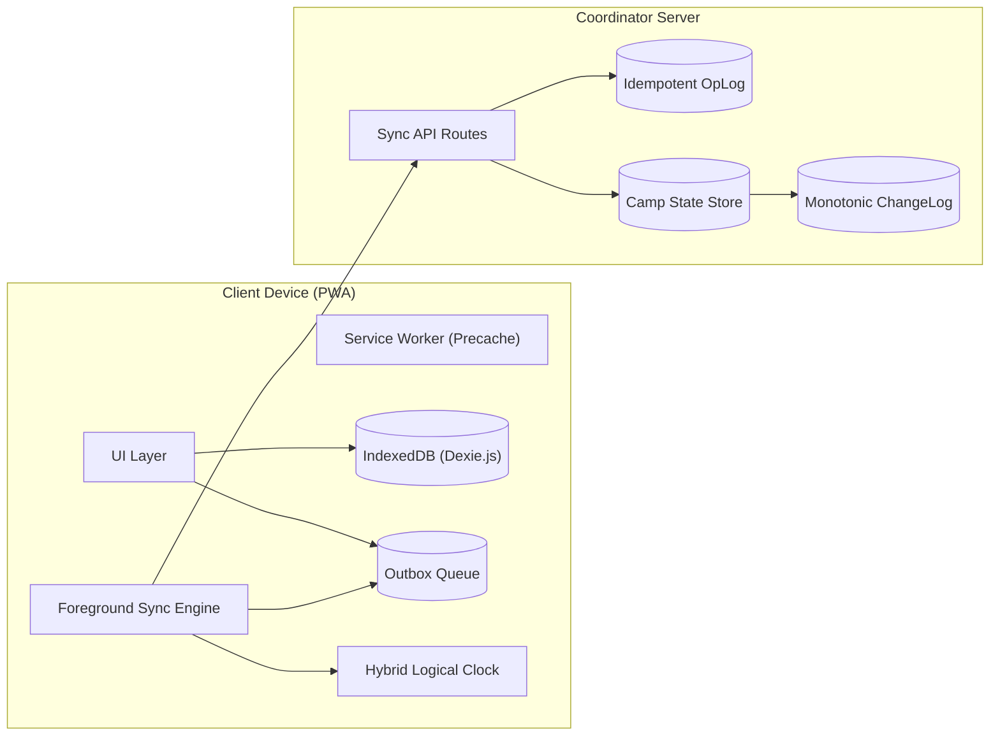

# ReliefSync

[](https://github.com/Sumanth069/ReliefSync)
[](https://github.com/Sumanth069/ReliefSync)
[](https://github.com/Sumanth069/ReliefSync)
[](https://github.com/Sumanth069/ReliefSync)

**ReliefSync** is an offline-first Progressive Web Application (PWA) built for disaster relief camps. It allows field volunteers to register displaced families, log relief distributions, and track inventory with zero network connectivity. When connectivity returns, changes synchronize safely through an **idempotent, field-level 3-way merge engine** that eliminates silent data overwrites.

---

## Requirements Fulfillment (PS ID: ALG-WEB-02)

| Requirement | Status | Implementation Details | Key File |
|---|---|---|---|
| **Offline Cache** | Complete | Service Worker precaches app shell, manifest, and offline fallback | [`public/sw.js`](public/sw.js) |
| **Offline CRUD** | Complete | Zero-latency optimistic local reads and writes to IndexedDB | [`src/lib/familyService.ts`](src/lib/familyService.ts) |
| **Pending Changes** | Complete | Immutable outbox queue with states: `PENDING`, `INFLIGHT`, `DONE`, `PARKED` | [`src/lib/types.ts`](src/lib/types.ts) |
| **Connectivity Detection** | Complete | Active probe (`/api/ping`, 3s timeout) catches "Lie-Fi" where Wi-Fi is active but uplink is dead | [`src/hooks/useConnectivity.ts`](src/hooks/useConnectivity.ts) |
| **Synchronization** | Complete | Idempotent batch push (`/api/sync/push`) and cursor-based pull (`/api/sync/pull`) | [`src/lib/syncEngine.ts`](src/lib/syncEngine.ts) |
| **Sync Status UX** | Complete | Real-time navbar status badge, per-record sync chips, and reconnect toasts | [`src/components/Navbar.tsx`](src/components/Navbar.tsx) |
| **Conflict Handling (Bonus)** | Complete | Field-level 3-way merge: non-overlapping fields auto-merge; overlapping collisions route to Conflict Inbox | [`src/components/ConflictInbox.tsx`](src/components/ConflictInbox.tsx) |

---

## System Architecture



### Core Design Principles
1. **The UI Never Waits on Network:** Every action writes immediately to IndexedDB and appends an operation to the local `outbox`.
2. **Foreground-First Sync:** Runs in the page foreground (`online` events, `visibilitychange`, write debounces) to ensure full compatibility across iOS Safari and Chromium.
3. **Untrusted Clocks:** Ordered via Hybrid Logical Clocks (`<wall_ms>-<counter>-<deviceId>`) to prevent timestamp corruption from skewed device clocks.

---

## Semantic Conflict Handling

In disaster relief, physical events cannot be rolled back. ReliefSync replaces generic Last-Write-Wins (LWW) with domain-aware resolution:

| Entity Type | Concurrent Edit Scenario | Resolution Strategy |
|---|---|---|
| **Family Profiles** | Non-overlapping fields edited on two phones (e.g. Phone vs Family Size) | **Auto-Merge**: Server merges both patches; increments field version vectors. |
| **Family Profiles** | Same field edited concurrently on two phones (e.g. Conflicting head names) | **Conflict Inbox**: Server leaves current value intact and creates an open `ConflictRecord`. Coordinator resolves via side-by-side diff. |
| **Aid Distribution** | Same family receives duplicate rations across two offline devices | **Anomaly Flag**: Handout is **never rejected** (the physical ration already left). Flagged as `DOUBLE_IN_ROUND` for coordinator audit. |
| **Stock Ledger** | Concurrent distributions drive inventory below zero | **Commutative Ledger**: Deltas sum up mathematically; negative balance triggers a `STOCK_DISCREPANCY` review. |

---

## Correctness Scoreboard (Automated Invariants)

ReliefSync includes an automated property test suite verifying synchronization correctness:

```bash
npm run test:sync
```

```text
====================================================
ReliefSync Synchronization Invariant Verification
====================================================
Test 1: Monotonic Cursor Sequence .................... PASSED
Test 2: Push Idempotency (Duplicate Op Replay) ....... PASSED
Test 3: Non-Overlapping Field 3-Way Auto-Merge ....... PASSED
Test 4: Collision Prevention (No Silent Overwrite) ... PASSED
Test 5: Relief Aid Anomaly Retention ................. PASSED
====================================================
5 of 5 Invariants Verified (0 Failures)
====================================================
```

---

## 3-Minute Evaluator Demo Script

1. **Test Offline Mutations:**
   * Open the app and click **"Cut Signal"** in the top navbar (or toggle Offline in DevTools).
   * Click **"Register Family (Offline)"** and submit. Notice instant write latency and the navbar badge switching to **"1 Queued Offline"**.
2. **Test Physical Anomaly Retention:**
   * In **"Aid Distribution"**, issue an item to a family twice in `Round 1`.
   * Confirm the handout: notice it is **retained with an `ANOMALY: DOUBLE HANDOUT` badge**, preserving ground truth.
3. **Test Conflict Resolution (The Bonus Criterion):**
   * Go to **"Conflict Inbox"** and click **"Simulate Offline Collision"**.
   * Review the side-by-side comparison card: **Local Device Edit** vs **Camp Authority Edit**.
   * Click **"Keep My Version"**, **"Accept Server Version"**, or type a custom hybrid merge to resolve live with zero data loss.
4. **Inspect Under the Hood:**
   * Click **"Diagnostics & Outbox Inspector"** in the footer to review the raw outbox queue, HLC ticks, and storage quota.

---

## Quickstart

```bash
# Clone and install
git clone https://github.com/Sumanth069/ReliefSync.git
cd ReliefSync
npm install

# Run correctness test suite
npm run test:sync

# Start local server
npm run dev
```

Open [http://localhost:3000](http://localhost:3000) (or `http://localhost:3001` if port 3000 is occupied).

---

### Tech Stack
- **Frontend / PWA:** Next.js 15 (App Router), React 19, Tailwind CSS, Lucide Icons, Service Worker precache.
- **Client Storage:** Dexie.js (IndexedDB wrapper) with reactive live queries.
- **Protocol:** Hybrid Logical Clock (HLC), client-generated UUIDv7, JSON patch outbox.
- **Backend API:** Next.js Route Handlers (`/api/ping`, `/api/sync/push`, `/api/sync/pull`).
